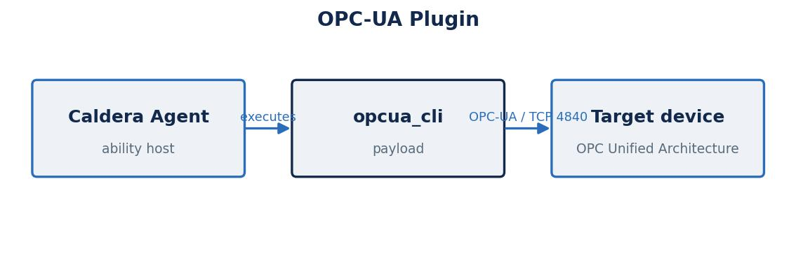

# OPC-UA
OPC Unified Architecture (OPC-UA) protocol abilities for Caldera for OT.

v1.0.0 released 3 Nov 2026

## Overview
The OPC-UA plugin provides __5__ unique abilities specific to the OPC-UA protocol. This is accomplished not through exploitation, but rather by leveraging native functionality within the protocol. The specification for the OPC-UA protocol is available free of charge from [the OPC Foundation](https://reference.opcfoundation.org/).

The following table outlines MITRE ATT&CK for ICS coverage provided by the OPC-UA plugin.

|Collection|Discovery|Execution|Impair-Process-Control|
|:--|:--|:--|:--|
|Monitor Process State|Remote System Discovery|Execution through API|Modify Parameter|

### Ability Overview Tables
The following table(s) list each plugin ability by their corresponding tactic.

#### Collection Abilities
|Name|Tactic|Technique|Technique Id|
|:--|:--|:--|:--|
|[OPC-UA - Read Node](#opc-ua---read-node)|collection|Monitor Process State|T0801|

#### Discovery Abilities
|Name|Tactic|Technique|Technique Id|
|:--|:--|:--|:--|
|[OPC-UA - Browse Address Space](#opc-ua---browse-address-space)|discovery|Remote System Discovery|T0846|
|[OPC-UA - Read Endpoints](#opc-ua---read-endpoints)|discovery|Remote System Discovery|T0846|

#### Execution Abilities
|Name|Tactic|Technique|Technique Id|
|:--|:--|:--|:--|
|[OPC-UA - Call Method](#opc-ua---call-method)|execution|Execution through API|T0871|

#### Impair-Process-Control Abilities
|Name|Tactic|Technique|Technique Id|
|:--|:--|:--|:--|
|[OPC-UA - Write Node](#opc-ua---write-node)|impair-process-control|Modify Parameter|T0836|


## Architecture
This section describes the main components of the plugin and how they interface.

### Block Diagram


The OPC-UA plugin exposes several new protocol specific abilities to your Caldera instance. The abilities are executed from a host running a Caldera agent via the corresponding payload. Abilities must target devices that support the OPC-UA protocol to achieve described effects. By default the plugin will use __4840__ for all communication.

### Payloads
The OPC-UA plugin includes 1 distinct payload(s) that implement the abilities:

- `opcua_cli`: &emsp; Generic OPC-UA client; one subcommand per ability, parameterized by facts.
  - Compatible with Linux, Windows, macOS
  - Compiled with PyInstaller (Python 3.10)

### Libraries
The following libraries were used to build the OPC-UA payloads:  

|Library|Version|License|
|:--|:--|:--|
|[asyncua](https://pypi.org/project/asyncua/)|[2.x](https://pypi.org/project/asyncua/)|[LGPL-3.0](https://github.com/FreeOpcUa/opcua-asyncio/blob/master/COPYING.LESSER)|

## Usage
This section describes how to initially deploy and execute the abilities present within the OPC-UA plugin.

### Deployment
1. Identify the target system you would like to communicate with via the OPC-UA protocol.
2. Identify a viable host for the Caldera agent that will be sending OPC-UA messages to the target system.
3. Deploy the Caldera agent to the viable host.
4. Run a combination of the OPC-UA plugin abilities to achieve the desired effect.  

*Reference the Caldera training plugin for a step-by-step tutorial on how to deploy an agent and run abilities via an operation.*

### Abilities
#### OPC-UA - Read Node
Read the value of an OPC-UA node (variable). Discloses a live process value,
setpoint, or status held by the server.
  

__Usage:__  
linux: (sh)  
```
COMMAND>> ./opcua_cli #{opcua.server.endpoint} --port #{opcua.server.port} read "#{opcua.node.id}"

```  

__Facts:__  
- `opcua.server.endpoint`: Target OPC-UA endpoint (host/IP, or a full opc.tcp:// URL)
- `opcua.server.port`: Target OPC-UA TCP port (default 4840)
- `opcua.node.id`: NodeId of the target node (read, or written for Write Node)
windows: (psh)  
```
COMMAND>> .\opcua_cli.exe #{opcua.server.endpoint} --port #{opcua.server.port} read "#{opcua.node.id}"

```  

__Facts:__  
- `opcua.server.endpoint`: Target OPC-UA endpoint (host/IP, or a full opc.tcp:// URL)
- `opcua.server.port`: Target OPC-UA TCP port (default 4840)
- `opcua.node.id`: NodeId of the target node (read, or written for Write Node)
darwin: (sh)  
```
COMMAND>> ./opcua_cli_darwin #{opcua.server.endpoint} --port #{opcua.server.port} read "#{opcua.node.id}"

```  

__Facts:__  
- `opcua.server.endpoint`: Target OPC-UA endpoint (host/IP, or a full opc.tcp:// URL)
- `opcua.server.port`: Target OPC-UA TCP port (default 4840)
- `opcua.node.id`: NodeId of the target node (read, or written for Write Node)
#### OPC-UA - Browse Address Space
Browse an OPC-UA server's address space from a starting node, enumerating the
nodes (objects and variables) it exposes. Maps out the process model for
targeting.
  

__Usage:__  
linux: (sh)  
```
COMMAND>> ./opcua_cli #{opcua.server.endpoint} --port #{opcua.server.port} browse --node "#{opcua.browse.node}" --depth #{opcua.browse.depth}

```  

__Facts:__  
- `opcua.server.endpoint`: Target OPC-UA endpoint (host/IP, or a full opc.tcp:// URL)
- `opcua.server.port`: Target OPC-UA TCP port (default 4840)
- `opcua.browse.node`: NodeId to start browsing from (e.g. i=85, the Objects folder)
- `opcua.browse.depth`: How many levels deep to browse
windows: (psh)  
```
COMMAND>> .\opcua_cli.exe #{opcua.server.endpoint} --port #{opcua.server.port} browse --node "#{opcua.browse.node}" --depth #{opcua.browse.depth}

```  

__Facts:__  
- `opcua.server.endpoint`: Target OPC-UA endpoint (host/IP, or a full opc.tcp:// URL)
- `opcua.server.port`: Target OPC-UA TCP port (default 4840)
- `opcua.browse.node`: NodeId to start browsing from (e.g. i=85, the Objects folder)
- `opcua.browse.depth`: How many levels deep to browse
darwin: (sh)  
```
COMMAND>> ./opcua_cli_darwin #{opcua.server.endpoint} --port #{opcua.server.port} browse --node "#{opcua.browse.node}" --depth #{opcua.browse.depth}

```  

__Facts:__  
- `opcua.server.endpoint`: Target OPC-UA endpoint (host/IP, or a full opc.tcp:// URL)
- `opcua.server.port`: Target OPC-UA TCP port (default 4840)
- `opcua.browse.node`: NodeId to start browsing from (e.g. i=85, the Objects folder)
- `opcua.browse.depth`: How many levels deep to browse
#### OPC-UA - Read Endpoints
Enumerate an OPC-UA server's endpoints and their security policies/modes.
Reveals the transport URLs and whether the server accepts anonymous / insecure
connections.
  

__Usage:__  
linux: (sh)  
```
COMMAND>> ./opcua_cli #{opcua.server.endpoint} --port #{opcua.server.port} endpoints

```  

__Facts:__  
- `opcua.server.endpoint`: Target OPC-UA endpoint (host/IP, or a full opc.tcp:// URL)
- `opcua.server.port`: Target OPC-UA TCP port (default 4840)
windows: (psh)  
```
COMMAND>> .\opcua_cli.exe #{opcua.server.endpoint} --port #{opcua.server.port} endpoints

```  

__Facts:__  
- `opcua.server.endpoint`: Target OPC-UA endpoint (host/IP, or a full opc.tcp:// URL)
- `opcua.server.port`: Target OPC-UA TCP port (default 4840)
darwin: (sh)  
```
COMMAND>> ./opcua_cli_darwin #{opcua.server.endpoint} --port #{opcua.server.port} endpoints

```  

__Facts:__  
- `opcua.server.endpoint`: Target OPC-UA endpoint (host/IP, or a full opc.tcp:// URL)
- `opcua.server.port`: Target OPC-UA TCP port (default 4840)
#### OPC-UA - Call Method
Call an OPC-UA method exposed by an object node. Server-defined methods can
trigger device actions (start/stop, reset, mode change); invoking one executes
functionality through the OPC-UA API.
  

__Usage:__  
linux: (sh)  
```
COMMAND>> ./opcua_cli #{opcua.server.endpoint} --port #{opcua.server.port} call-method "#{opcua.method.object}" "#{opcua.method.node}"

```  

__Facts:__  
- `opcua.server.endpoint`: Target OPC-UA endpoint (host/IP, or a full opc.tcp:// URL)
- `opcua.server.port`: Target OPC-UA TCP port (default 4840)
- `opcua.method.object`: NodeId of the object that owns the method
- `opcua.method.node`: NodeId of the method to call
windows: (psh)  
```
COMMAND>> .\opcua_cli.exe #{opcua.server.endpoint} --port #{opcua.server.port} call-method "#{opcua.method.object}" "#{opcua.method.node}"

```  

__Facts:__  
- `opcua.server.endpoint`: Target OPC-UA endpoint (host/IP, or a full opc.tcp:// URL)
- `opcua.server.port`: Target OPC-UA TCP port (default 4840)
- `opcua.method.object`: NodeId of the object that owns the method
- `opcua.method.node`: NodeId of the method to call
darwin: (sh)  
```
COMMAND>> ./opcua_cli_darwin #{opcua.server.endpoint} --port #{opcua.server.port} call-method "#{opcua.method.object}" "#{opcua.method.node}"

```  

__Facts:__  
- `opcua.server.endpoint`: Target OPC-UA endpoint (host/IP, or a full opc.tcp:// URL)
- `opcua.server.port`: Target OPC-UA TCP port (default 4840)
- `opcua.method.object`: NodeId of the object that owns the method
- `opcua.method.node`: NodeId of the method to call
#### OPC-UA - Write Node
Write a value to an OPC-UA node. Changing a command or setpoint node alters how
the process is controlled - e.g. opening a valve or changing a drive setpoint -
an unauthorized manipulation of the process.
  

__Usage:__  
linux: (sh)  
```
COMMAND>> ./opcua_cli #{opcua.server.endpoint} --port #{opcua.server.port} write "#{opcua.node.id}" #{opcua.write.value} --type #{opcua.write.type}

```  

__Facts:__  
- `opcua.server.endpoint`: Target OPC-UA endpoint (host/IP, or a full opc.tcp:// URL)
- `opcua.server.port`: Target OPC-UA TCP port (default 4840)
- `opcua.node.id`: NodeId of the target node (read, or written for Write Node)
- `opcua.write.value`: Value to write to the node
- `opcua.write.type`: Data type of the written value (bool, int, float, string)
windows: (psh)  
```
COMMAND>> .\opcua_cli.exe #{opcua.server.endpoint} --port #{opcua.server.port} write "#{opcua.node.id}" #{opcua.write.value} --type #{opcua.write.type}

```  

__Facts:__  
- `opcua.server.endpoint`: Target OPC-UA endpoint (host/IP, or a full opc.tcp:// URL)
- `opcua.server.port`: Target OPC-UA TCP port (default 4840)
- `opcua.node.id`: NodeId of the target node (read, or written for Write Node)
- `opcua.write.value`: Value to write to the node
- `opcua.write.type`: Data type of the written value (bool, int, float, string)
darwin: (sh)  
```
COMMAND>> ./opcua_cli_darwin #{opcua.server.endpoint} --port #{opcua.server.port} write "#{opcua.node.id}" #{opcua.write.value} --type #{opcua.write.type}

```  

__Facts:__  
- `opcua.server.endpoint`: Target OPC-UA endpoint (host/IP, or a full opc.tcp:// URL)
- `opcua.server.port`: Target OPC-UA TCP port (default 4840)
- `opcua.node.id`: NodeId of the target node (read, or written for Write Node)
- `opcua.write.value`: Value to write to the node
- `opcua.write.type`: Data type of the written value (bool, int, float, string)

### Source Code
The source code for the OPC-UA plugin can be found inside this plugin's [src directory](/src/).

### Copyright Notice
OPC-UA and OPC Unified Architecture are specifications of the OPC Foundation,
16101 N 82nd Street, Suite 3B, Scottsdale, AZ 85260, USA.

This Caldera plugin is named OPC-UA in order to describe its scope and purpose. This
plugin is not produced by or affiliated with the OPC Foundation. The `opcua_cli` payload
is built on the open-source [asyncua](https://pypi.org/project/asyncua/) library (LGPL-3.0).
